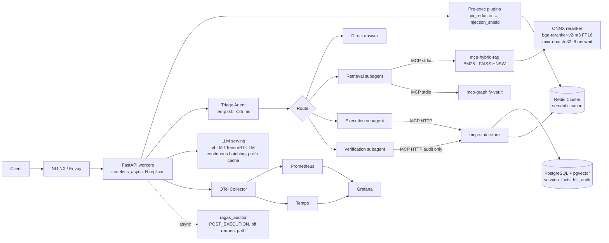

# design.md — "The Unreliable Assistant" → Enterprise Agentic Platform

Written for: engineers building the system and the reviewers who approve it.
Status: DRAFT for review (Gate 1). Not yet locked. Locking requires sign-off on Section 9 (Open Decisions).
Sources: `Unreliable_Assistant_MidCheck_Enterprise_Blueprint_v2.docx` (spec, "Blueprint") and `Post_Hardening_Engineering_Audit_Report.docx` (claimed results, "Audit"). Where they conflict, the resolution is recorded in Section 8.

---

## 1.1 System Charter & Hard Boundaries

### Purpose
An MCP-enabled, plugin-extensible agentic assistant that answers enterprise questions from a governed knowledge base, performs tenant-scoped read and write actions through tools, and sustains 50,000 concurrent virtual users (VUs) at p95 ≤ 450 ms and p99 ≤ 600 ms.

### In scope
- Grounded Q&A over enterprise policies, SOPs, and product catalogs (hybrid RAG).
- Tool-mediated lookups (read tier) and workflow transitions / form submissions (mutate tier, HITL-gated).
- Multi-tenant operation with strict isolation of data, cache, and audit records.
- Observability, red-team, and load-test harnesses as first-class deliverables.

### Non-goals (hard boundaries)
1. **No autonomous clinical, financial, or legal execution.** Any Tier 3 (mutating) action in these domains requires a human approval record before execution.
2. **No Tier 3 action without a `PENDING_APPROVAL` → approved transition.** No bypass flag exists.
3. **No raw PII persistence.** Redacted text only reaches logs, cache, and LLM prompts.
4. **No open web access** from the Execution or Retrieval subagents.
5. **No unbounded agent loops.** Every request terminates in `DONE` or `HALTED_*`.
6. **Not a general chat product.** Out-of-scope queries get `REJECT_OOS`.

### User personas
| Persona | Needs | Primary surface |
|---|---|---|
| End user (employee/customer) | Grounded, cited answers; quick responses | `POST /api/v1/agent/query` |
| Approver / reviewer | Approve or reject Tier 3 actions | HITL queue (API + Streamlit Tab 1) |
| Operator / SRE | Health, breakers, runbooks, traces | Grafana, Streamlit Tabs 3, 5, 6 |
| Compliance auditor | Tamper-evident audit trail, tenant evidence | Audit log export, `session_facts` |
| Knowledge owner | Keep policies current and linked | Obsidian vault (`knowledge_vault/`) |
| Developer | Build, test, and verify against the KPIs | CI, Streamlit Tabs 2, 4 |

---

## 1.2 MCP Tool & Data Contracts

All tool traffic is MCP JSON-RPC 2.0. Local workers use stdio; distributed services use Streamable HTTP. Every call passes through `ToolExecutionHarness` (Section 1.2.4).

### 1.2.1 Server inventory
| Server | Transport | Tools | Resources | Tier ceiling |
|---|---|---|---|---|
| `mcp-hybrid-rag` | stdio (long-lived process, not spawned per call) | `hybrid_retrieve` | `rag://chunks/{chunk_id}` | TIER_1_READ |
| `mcp-graphify-vault` | stdio (long-lived) | `graph_subgraph` | `vault://notes/{note_id}` | TIER_1_READ |
| `mcp-state-store` | Streamable HTTP, pool_size 200 | `session_facts_get`, `session_facts_put`, `workflow_transition`, `hitl_request`, `hitl_decide`, `audit_append` | — | TIER_3_MUTATE (only via harness-approved calls) |

### 1.2.2 Tool schemas (Pydantic v2 models; JSON Schema is generated from these)

**`hybrid_retrieve` — input**
```json
{
  "type": "object",
  "required": ["request_id", "tenant_id", "query"],
  "additionalProperties": false,
  "properties": {
    "request_id": {"type": "string", "format": "uuid", "description": "UUIDv4"},
    "tenant_id":  {"type": "string", "pattern": "^tenant_[a-z0-9_-]{1,56}$"},
    "query":      {"type": "string", "minLength": 3, "maxLength": 512},
    "top_k":      {"type": "integer", "minimum": 1, "maximum": 50, "default": 50},
    "rerank_k":   {"type": "integer", "minimum": 1, "maximum": 4, "default": 4},
    "threshold":  {"type": "number", "minimum": 0, "maximum": 1, "default": 0.42}
  }
}
```

**`hybrid_retrieve` — output**
```json
{
  "type": "object",
  "required": ["abstain", "chunks", "stage_ms"],
  "properties": {
    "abstain": {"type": "boolean"},
    "chunks": {"type": "array", "maxItems": 4, "items": {
      "type": "object",
      "required": ["chunk_id", "chunk_hash", "text", "bm25", "cosine", "rrf_rank", "rerank_score"],
      "properties": {
        "chunk_id": {"type": "string", "pattern": "^[a-z0-9_-]{1,128}$"},
        "chunk_hash": {"type": "string", "pattern": "^[a-f0-9]{64}$"},
        "text": {"type": "string", "maxLength": 4096},
        "bm25": {"type": "number"}, "cosine": {"type": "number"},
        "rrf_rank": {"type": "integer", "minimum": 1, "maximum": 40},
        "rerank_score": {"type": "number", "minimum": 0, "maximum": 1}
      }}},
    "stage_ms": {"type": "object", "properties": {
      "bm25": {"type": "number"}, "biencoder": {"type": "number"},
      "rrf": {"type": "number"}, "rerank": {"type": "number"}}}
  }
}
```

**`graph_subgraph` — input:** `{ "anchor_id": "^[A-Z]{2,4}-[0-9]{3,6}$|^note_[a-z0-9_-]+$", "depth": 0..2 (max 2), "max_tokens": 1..320 }`. Output: `{ "nodes": [...], "edges": [...], "token_estimate": int }`.

**`session_facts_put` — input:** `{ "request_id": UUIDv4, "tenant_id": tenant regex, "session_id": UUIDv4, "fact_key": "^[a-z_]{3,64}$", "fact_value": string (≤ 1024 chars), "source_chunk_hash": sha256 hex }`. Writes only verified facts (see Gate 5).

**`workflow_transition` / `hitl_request` — input (Tier 3):** `{ "request_id": UUIDv4, "idempotency_key": UUIDv4, "tenant_id": tenant regex, "action": "^[a-z_]{3,48}$", "args": object (validated per action), "risk_tier": "TIER_3_MUTATE" }`. A Tier 3 call with no matching approved `hitl_decide` record is rejected with `E_HITL_PENDING` (-32004).

**Entity formats (used by auto-repair):**
- SKU: `^SKU-[0-9]{3}$` (e.g., `SKU-099`). Repair: `SKU99` → `SKU-099`.
- LOT: `^LOT-[0-9]{5}$`. Repair: `lot 44` → `LOT-00044`.
- Tenant: `^tenant_[a-z0-9_-]{1,56}$`.

### 1.2.3 Error codes (JSON-RPC)
| Code | Name | Meaning | Client action |
|---|---|---|---|
| -32600 | `E_INVALID_REQUEST` | Malformed JSON-RPC envelope | Fix client |
| -32602 | `E_VALIDATION` | Schema violation not repairable | Return structured remediation prompt |
| -32001 | `E_TENANT_FORBIDDEN` | `tenant_id` mismatch with session / token | Deny; log security event |
| -32002 | `E_TIMEOUT` | Per-step or MCP timeout exceeded | Retry only if budget remains |
| -32003 | `E_BREAKER_OPEN` | `(tool_name, canonical_args_hash)` breaker tripped | Show remediation; do not retry |
| -32004 | `E_HITL_PENDING` | Tier 3 action awaiting approval | Show pending status |
| -32005 | `E_RBAC_DENIED` | Tier ceiling exceeded for this subagent | Deny |
| -32006 | `E_IDEMPOTENT_REPLAY` | Same `idempotency_key`, different args | Deny; log |
| -32007 | `E_DEGRADED` | Dependency down; fallback served | Serve fallback; flag response |

### 1.2.4 ToolExecutionHarness (every MCP call, in order)
1. **Strict validation**: Pydantic v2 `strict=True`, `extra="forbid"`.
2. **Deterministic auto-repair** (regex rules only; no LLM in repair). At most one repair pass. Repaired values are logged with the original value.
3. **RBAC tier check**: `TIER_1_READ` / `TIER_2_COMPUTE` / `TIER_3_MUTATE` against the calling subagent's ceiling (Section 1.2.1 and Gate 7).
4. **Idempotency**: `UUIDv4 idempotency_key` required on every mutating call; replay with identical args returns the stored result; replay with different args → `E_IDEMPOTENT_REPLAY`.

---

## 1.3 Distributed Topology & Data Flow



**Rules**
- API workers hold no session state; all state is in Redis or Postgres.
- Each MCP server runs in its own bulkhead pool (Section 1.6 and Gate 9): `rag_pool=64`, `db_pool=128`, `llm_pool=256` per replica.
- The RAGAS auditor and OTel export are **asynchronous** and never on the request path (Section 1.4 depends on this).

---

## 1.4 End-to-End Latency Budget (p95 ≤ 450 ms, p99 ≤ 600 ms)

### Nominal path (HYBRID_RAG, the heaviest route)
| # | Hop | p95 budget (ms) | Basis |
|---|---|---:|---|
| 1 | Ingress: gateway, TLS, auth, JSON parse | 10 | Assumption |
| 2 | `hook.pre` (PII + injection) | 15 | KPI-01 |
| 3 | `cache.lookup` (Redis) | 2 | Blueprint ("sub-ms") |
| 4 | `triage.classify` | 25 | KPI-05 |
| 5 | `mcp.rag.bm25` | 12 | KPI-07 |
| 6 | `mcp.rag.biencoder` (FAISS HNSW) | 25 | KPI-08 |
| 7 | `mcp.rag.rrf` | 3 | Gate 3 |
| 8 | `mcp.rag.rerank` | 45 | KPI-09 |
| 9 | MCP serialization, 3 calls × 4 ms | 12 | KPI-30 |
| 10 | `graph_subgraph` (≤ 320 tokens) | 15 | Assumption |
| 11 | `session_facts` read | 5 | Assumption |
| 12 | `llm.generate` (TTFT ≤ 180 ms + stream) | 250 | KPI-25 |
| 13 | Egress: serialize and send | 10 | Assumption |
| | **Nominal total** | **429** | Margin to 450: **21 ms** |

Items 5–12 form the **bounded loop**. Nominal loop time is 367 ms, and the loop ceiling is 380 ms (Section 1.7, ADR-04). Worst case: 10 + 15 + 2 + 25 + 380 + 10 = **442 ms**, still under 450.

### Other routes
| Route | Nominal p95 | Note |
|---|---:|---|
| `DIRECT_ANSWER` | ~ 60 ms + LLM | No retrieval hops |
| `HYBRID_RAG`, abstention (rerank top score < 0.42) | ≤ 160 ms | Deterministic response in ≤ 90 ms (Gate 9.3) |
| `TRANSACTION_EXEC` | Read path + HITL | Pending HITL is not a latency failure; it returns `E_HITL_PENDING` |
| `REJECT_OOS` | ≤ 40 ms | No LLM call |

### Latency rules that make the budget hold
- RAGAS scoring and OTel export run asynchronously (cost removed from the request path).
- The LLM step has its own 250 ms timeout. The 120 ms `per_step_timeout` applies to tool calls only.
- BM25 and the bi-encoder may run in parallel to save up to 12 ms. This is an allowed optimization, not a requirement, and the budget above does not assume it.
- **Capacity check (Little's law):** at 8,500 RPS and a 35% cache hit ratio, about 5,525 requests/s reach the LLM. At 250 ms each, that needs roughly **1,380 generations in flight fleet-wide**. Size `llm_pool` and the serving fleet to this number, not to per-replica defaults. The Audit does not report LLM capacity, so this is unverified.

---

## 1.5 KPI & SLA Gate Matrix (36 stage-level KPIs)

All KPIs are CI-blocking unless marked "prod". Thresholds are hard pass/fail. Measurement tool is the source named in the Blueprint.

| ID | Stage | KPI | Threshold | Measured by |
|---|---|---|---|---|
| KPI-01 | Ingress & Triage | Pre-hook guardrail latency (p95) | ≤ 15 ms | OTel `hook.pre` |
| KPI-02 | Ingress & Triage | PII redaction recall (email/phone/SSN/obfuscated) | ≥ 99.8% | Presidio + regex audit |
| KPI-03 | Ingress & Triage | Prompt-injection block rate (direct + indirect) | ≥ 99.5% | Red-team benchmark |
| KPI-04 | Ingress & Triage | Triage routing accuracy | ≥ 97.0% | Labeled intent set |
| KPI-05 | Ingress & Triage | Triage classification latency (p95) | ≤ 25 ms | OTel `triage` |
| KPI-06 | Ingress & Triage | False-positive refusal on benign queries | ≤ 1.0% | Benign control set |
| KPI-07 | Hybrid Retrieval | BM25 latency (p95) | ≤ 12 ms | OTel `rag.bm25` |
| KPI-08 | Hybrid Retrieval | Bi-encoder + FAISS latency (p95) | ≤ 25 ms | OTel `rag.dense` |
| KPI-09 | Hybrid Retrieval | Cross-encoder rerank latency (p95) | ≤ 45 ms | OTel `rag.rerank` |
| KPI-10 | Hybrid Retrieval | Hybrid context recall @50 | ≥ 0.92 | RAGAS / IR eval |
| KPI-11 | Hybrid Retrieval | Post-rerank context precision @4 | ≥ 0.88 | RAGAS |
| KPI-12 | Hybrid Retrieval | MRR@4 | ≥ 0.85 | IR benchmark script |
| KPI-13 | Hybrid Retrieval | nDCG@4 | ≥ 0.86 | IR benchmark script |
| KPI-14 | Agent & Loop | Tool schema first-pass validation rate | ≥ 96.0% | Pydantic telemetry |
| KPI-15 | Agent & Loop | Auto-repair success on malformed args | ≥ 90.0% | Harness metrics |
| KPI-16 | Agent & Loop | Infinite-loop escape rate | 100.0% | Chaos loop suite |
| KPI-17 | Agent & Loop | Mean ReAct steps per completed task | ≤ 2.2 | OTel trace count |
| KPI-18 | Agent & Loop | Context drift score (goal cosine alignment) | ≥ 0.85 | Embedding drift audit |
| KPI-19 | Agent & Loop | Tier 3 HITL gate enforcement | 100.0% | Audit log integrity |
| KPI-20 | Generation & RAGAS | RAGAS faithfulness | ≥ 0.92 | Post-hook RAGAS |
| KPI-21 | Generation & RAGAS | RAGAS answer relevancy | ≥ 0.90 | Post-hook RAGAS |
| KPI-22 | Generation & RAGAS | RAGAS context entity recall | ≥ 0.85 | Post-hook RAGAS |
| KPI-23 | Generation & RAGAS | Unanswerable-query abstention accuracy | ≥ 98.0% | Negative test set |
| KPI-24 | Generation & RAGAS | Unsupported-claim / hallucination rate | ≤ 0.5% | NLI claim verifier |
| KPI-25 | Generation & RAGAS | Time-to-first-token (p95) | ≤ 180 ms | FastAPI stream metric |
| KPI-26 | Token & Graphify | Prompt token reduction (Graphify + Obsidian) | ≥ 45.0% | Token counter hook |
| KPI-27 | Token & Graphify | Semantic cache hit ratio (steady state) | ≥ 35.0% | Redis hit/miss metric |
| KPI-28 | Token & Graphify | Cross-tenant cache isolation | 100.0% (0 leaks) | Concurrency probe |
| KPI-29 | Token & Graphify | Cost per 1,000 queries | ≤ $0.45 | OTel token-cost calc |
| KPI-30 | Token & Graphify | MCP JSON-RPC serialization overhead (p95) | ≤ 4 ms | MCP client timer |
| KPI-31 | Scale & Load | E2E latency p50 @ 50K VUs | ≤ 240 ms | k6 + JMeter |
| KPI-32 | Scale & Load | E2E latency p95 @ 50K VUs | ≤ 450 ms | k6 + JMeter |
| KPI-33 | Scale & Load | E2E latency p99 @ 50K VUs | ≤ 600 ms (target 590) | k6 + JMeter |
| KPI-34 | Scale & Load | HTTP 5xx rate @ 50K VUs | ≤ 0.05% | k6 / JMeter |
| KPI-35 | Scale & Load | Sustained throughput | ≥ 8,500 RPS | k6 / JMeter |
| KPI-36 | Scale & Load | RSS growth over 1-hour soak | ≤ 3.0% | Prometheus node exporter |

**Note on "200–600 ms":** the Blueprint's target is a range. The enforced gates are p50 ≤ 240, p95 ≤ 450, p99 ≤ 600. The 200 ms lower bound is not checked.

### Audit claims vs. this design
The Audit reports measured results. This repository contains no code, load-test output, or dashboards, so **none of its numbers are verified here**. Treat them as claims until the artifacts are attached.

| Claim in Audit | Gate it must meet | Status |
|---|---|---|
| p95 390 ms, p99 540 ms | KPI-32/33 | Unverified |
| 9,240 RPS at 50K VUs | KPI-35 | Unverified |
| RAGAS triad 0.94 / 0.91 / 0.89 (Faithfulness / Precision / Recall) | Faithfulness ≥ 0.92, Precision ≥ 0.88, Recall ≥ 0.85 (Gate 3 release gates) | Unverified. Numbers would pass, but the triad is not KPI-20/21/22: KPI-21 is answer relevancy and KPI-22 is context entity recall, which the Audit does not report |
| 99.9% PII/adversarial block | KPI-02 / 03 | Unverified |
| 1,320 tokens / 1K queries ($0.38) | KPI-26 / 29 | Unverified; measured reduction ≈ 53.7% |
| "All 36 KPIs passed" | All | Audit's table shows six metric rows; the other KPIs have no numbers in the document |
| "Zero security breaches" | — | No evidence attached |

---

## 1.6 Failure Mode & Effects Analysis (FMEA, 12 rows)

| # | Component failure | Detection | Deterministic fallback | Residual risk |
|---|---|---|---|---|
| 1 | **Redis down / timeout** | `cache.lookup` > 2 ms or connection error | Bypass cache; continue to triage. Emit `cache_degraded`. Tenant isolation holds because no shared key is read | Latency + LLM cost up |
| 2 | **`mcp-hybrid-rag` crash or hang** (JSON-RPC > 150 ms, > 1% rate) | Timeout counter | Trip bulkhead circuit; fail over to cached read-replica index; restart worker. If none: abstain with `E_DEGRADED` | Stale index |
| 3 | **Reranker timeout** (> 45 ms) | Stage timer | Return RRF top-4 flagged `rerank_unavailable`; enforce extractive-quote mode; no abstention short-circuit | Hallucination risk up; quote mode limits it |
| 4 | **FAISS index missing or corrupt** | Load-time check at worker start | Disable stage 2; BM25-only; flag `dense_unavailable`; alert | Recall drop (KPI-10 fails in degraded mode) |
| 5 | **`mcp-state-store` down** | Health check; HTTP error | Read-only degraded mode: no `session_facts` write, **all Tier 3 rejected (fail closed)** | Session context lost for the window |
| 6 | **`mcp-graphify-vault` down** | Timeout | Skip pruning; inject raw top-4 chunks (≈ 1,400 tokens vs. 320) | Token cost up; KPI-26 fails in this state |
| 7 | **LLM 429** | HTTP 429 | One retry with jittered backoff only if loop budget remains ≥ 150 ms; else return extractive answer from top chunk, `E_DEGRADED` | Lower answer quality |
| 8 | **LLM stall / timeout** (> 250 ms step) | Step timer | Cancel stream; return extractive answer; record `llm_timeout` | Partial answer risk; flagged |
| 9 | **Triage misroute** | Confidence below threshold | Default to `HYBRID_RAG` (read-only). **Never default to `TRANSACTION_EXEC`** | Unneeded retrieval latency |
| 10 | **PII redactor or injection shield exception** | Plugin exception | **Fail closed**: reject request with 503 and `Retry-After` | Availability loss, by design |
| 11 | **Postgres unavailable during HITL write** | `hitl_request` error | Reject the Tier 3 action; no partial write; no execution | User must retry |
| 12 | **OTel collector down** | Exporter error | Bounded in-memory queue; drop oldest spans; never block the request | Gaps in traces (counted) |

---

## 1.7 Architecture Decision Records (ADRs)

### ADR-01 — Hybrid retrieval: RRF over weighted-score fusion
- **Decision:** Fuse BM25 (k1 = 1.25, b = 0.75, top_k = 50) and dense (bge-large-en-v1.5, 512-token chunks, 64 overlap, FAISS HNSW efSearch = 64) with Reciprocal Rank Fusion (k = 60), dedup by `chunk_hash`, pool = 40. Rerank to top 4 with the cross-encoder, threshold 0.42.
- **Why:** BM25 and cosine scores are on different scales, so weighted sums need per-query normalization and an extra tuned weight. RRF uses ranks only and has one parameter.
- **Consequence:** No fusion weight exists to tune. The `RRF k` slider in Streamlit Tab 2 is the only fusion knob.
- **Alternatives rejected:** Weighted sum (scale-sensitive); dense-only (keyword blindness on SKU/LOT codes, the documented 38.6% hallucination cause).

### ADR-02 — ONNX FP16 for the reranker; INT8 only on evidence
- **Decision:** Ship `bge-reranker-v2-m3` in FP16, batch 32, `max_len` 512, micro-batch wait 8 ms.
- **Why:** FP16 preserves ranking quality. The Blueprint mentions both FP16 and INT8 (sub-35 ms).
- **Condition for INT8:** Only if KPI-09 (≤ 45 ms) fails, and only if RAGAS faithfulness (KPI-20 ≥ 0.92) and KPI-11 still pass after quantization.

### ADR-03 — Redis key isolation (SHA-256 of tenant, user, and normalized query)
- **Decision:** Key = `SHA256(tenant_id ":" user_id ":" norm_query)`, prefix-enforced, with TTL 300 s ± 45 s jitter.
- **Why:** Blueprint-mandated. No cross-user cache reads, which removes the cross-user leak class.
- **Trade-off (flagged):** Per-user keys prevent cross-user sharing, so KPI-27 (≥ 35% hit ratio) is only reachable through repeat queries by the same user. A tenant-scoped key with a per-user ACL check on the cached response would raise hits, at the cost of relying on the ACL check. **Decided: per-user keys kept (§ 9.1).** Revisit only if the measured hit ratio falls short.

### ADR-04 — Bounded ReAct loops
- **Decision:** State machine `INIT → TRIAGE → REASONING → TOOL_CALL → OBSERVATION → VERIFY → DONE | HALTED_*`. `max_iterations = 5`. `per_step_timeout = 120 ms` (tool calls). LLM step timeout = 250 ms. **`total_loop_budget = 380 ms`** (Blueprint says 450 ms; see Section 8). No recursive self-call without a state mutation.
- **Why:** 450 ms loop + 35 ms ingress and guard + egress exceeds the 450 ms p95 gate. The 380 ms ceiling keeps the worst case at 442 ms.
- **Circuit breaker:** trips when `(tool_name, canonical_args_hash)` fails ≥ 2 times within the request. Transitions to `HALTED_BREAKER` with a remediation prompt.

---

## 1.8 Plugin & Lifecycle Configuration (from `mcp_config.json`, verified against design)

- `pii_redactor` — PRE_EXECUTION, priority 10, **fail_closed: true**
- `injection_shield` — PRE_EXECUTION, priority 20, **fail_closed: true**
- `circuit_breaker` — TOOL_DISPATCH, priority 10, `max_identical_calls: 2`
- `ragas_auditor` — POST_EXECUTION, priority 10, `min_faithfulness: 0.92`, **async**
- `otel_exporter` — ALL_SPANS, endpoint `http://localhost:4317` (dev only; production uses the collector address from config)

Plugins are pluggy/entry-point hooks. They are hot-swappable only when a new version passes the plugin contract tests. Disabling `pii_redactor` or `injection_shield` at runtime is not permitted in production (Streamlit Tab 3 must show these as locked).

---

## 1.9 Agents & Routing (Gates 6, 7, 9)

### Triage Agent
- `temperature = 0.0`, distilled classifier, ≤ 25 ms p95.
- Output: `{intent, domain, risk_tier, complexity}` → one of `DIRECT_ANSWER`, `HYBRID_RAG`, `TRANSACTION_EXEC`, `REJECT_OOS`.
- Low confidence → `HYBRID_RAG`. It never routes to `TRANSACTION_EXEC` without high confidence and a Tier 3 classification.

### Subagents
| Subagent | Responsibility | MCP servers | Guardrail |
|---|---|---|---|
| Retrieval | Query rewrite, 3-stage hybrid RAG, citations | `mcp-hybrid-rag`, `mcp-graphify-vault` | Read-only; cannot call mutating tools |
| Execution | Schema validation, form submission, workflow transitions | `mcp-state-store` | No RAG or web; Tier 3 triggers HITL freeze |
| Verification | Claim-to-chunk NLI check, RAGAS triad, OTel log | `mcp-state-store` (audit append only) | Independent context; can veto ungrounded drafts |

Note: the Blueprint's Gate 2 diagram calls the third subagent "Audit." It is the **Verification** subagent here (Section 8).

### Reliability patterns (Gate 9)
- **Bulkhead:** `rag_pool=64`, `db_pool=128`, `llm_pool=256`, isolated per MCP server, so a slow reranker never blocks health checks or triage.
- **Deterministic abstention:** rerank top score < 0.42 → fixed abstention response in ≤ 90 ms, with no LLM call.
- **Async HITL:** Tier 3 writes `PENDING_APPROVAL` to Postgres and pauses until an authorized reviewer decides through UI or API.

### Context retention (Gate 5)
1. **`GoalAnchorBlock`** (immutable): original intent, normalized entity IDs, active policy constraints. Placed at index 0 of every ReAct prompt.
2. **Observation compression**: strip boilerplate JSON keys; truncate each observation to ≤ 180 tokens.
3. **Sliding window**: last 3 ReAct turns in hot memory; verified facts persisted to Postgres `session_facts` keyed by `session_id`.

---

## 1.10 Observability (Gate 10)

- W3C `traceparent` on every hop. Spans: `hook.pre`, `cache.lookup`, `triage.classify`, `mcp.rag.bm25`, `mcp.rag.biencoder`, `mcp.rag.rrf`, `mcp.rag.rerank`, `agent.react.step`, `llm.generate`, `hook.post.ragas`.
- Pipeline: OTel Collector → Prometheus + Tempo → Grafana.
- Alert thresholds (corrected; see Section 8): **warn** at p95 > 400 ms for 60 s, **page** at p95 > 450 ms for 60 s. The Blueprint's 550 ms alert sits above the SLA and would fire too late.

### Incident runbook (from Gate 11)
| Scenario | Alert | Mitigation |
|---|---|---|
| Latency breach | p95 > 450 ms for 60 s | Raise cache threshold to cosine ≥ 0.92; drop BM25 / dense `top_k` 50 → 25 |
| Hallucination surge | RAGAS faithfulness < 0.90 over 5 min | Raise rerank cutoff 0.42 → 0.55; strict extractive-quote mode |
| MCP server hang | JSON-RPC timeout > 150 ms, > 1% | Trip bulkhead; failover to read-replica index; restart worker |
| Cache leak / stampede | Tenant key collision or Redis CPU > 85% | Enforce key prefix; jittered TTL |

---

## 1.11 Governance & Security (Gates 13–14)

- **Audit log:** SHA-256 hash chain, `hash_n = SHA256(prev_hash || event_payload)`. Verified by a scheduled job; a break is a Sev-1.
- **Tenant isolation:** `tenant_id` in every Postgres query and every Redis key. Enforced by a repository layer, plus a test that fails if a query omits it.
- **Zero raw PII persistence:** logs, cache, traces, and `session_facts` store redacted text only.
- **Signed MCP manifests:** each server's manifest is signed; the host verifies the signature at connect time.
- **Red team (100 prompts):** (1) direct jailbreaks and prompt extraction; (2) indirect injection in retrieved chunks; (3) multi-turn crescendo; (4) Unicode homoglyph and `name[at]domain` PII; (5) argument overflow and SQLi fuzzing.

---

## 1.12 Scale & Load Profile (Gates 15–16)

- Stateless FastAPI workers behind NGINX/Envoy, horizontally scaled.
- Redis Cluster for cache. ONNX bi-encoder and reranker workers with micro-batching (batch 32, max wait 8 ms).
- LLM serving with continuous batching and prefix caching.
- **k6** (`load_tests/k6_50k_load.js`): ramp 10K → 50K over 5 min, sustain 5 min, ramp down. Thresholds: `p(50) < 240`, `p(95) < 450`, `p(99) < 600`, `http_req_failed < 0.0005`, `checks > 0.999`. The Blueprint uses `p(50) < 250`; corrected to 240 to match KPI-31.
- **JMeter** (`load_tests/jmeter_50k_plan.jmx`): 1 controller, 10 workers × 5,000 threads = 50,000 VUs, ramp-up 180 s, 600 s duration, CLI mode.
- **Load-test scope rule:** The k6 script keys users as `user_${vuId}`. Use realistic repeat-query distributions for the cache hit ratio. Unique users per VU will produce a near-zero hit ratio by construction.

---

## 1.13 Token Optimization (Gate 17)

- Atomic Obsidian notes in `knowledge_vault/`, each with YAML frontmatter (`id`, `domain`, `risk_tier`, `version`) and `[[wikilinks]]`.
- `graphify build ./src ./knowledge_vault --output graph.json` → structural graph of Python modules, Pydantic schemas, and policy nodes.
- At runtime, `graph_subgraph` resolves the anchor and traverses ≤ depth 2, injecting only the connected subgraph (≈ 320 tokens vs. ≈ 1,400 for a raw chunk dump).
- Target: ≥ 45% prompt token reduction (KPI-26). The Blueprint also cites 55% and the Audit 52.4%. The gate is 45%.

---

## 1.14 Developer Workbench (Gate 18)

Streamlit `app.py`, six tabs:
1. **Architecture & workflow:** `design.md` checklist, `docs/workflow_orchestration.png`, triage console, ReAct trace, Tier 3 approve/reject queue.
2. **3-stage RAG lab:** BM25, cosine, RRF, and cross-encoder scores side by side; sliders for `k1`, `b`, `RRF k`, `threshold`.
3. **MCP & plugin inspector:** server status, JSON-RPC payloads, hot-toggle for non-locked plugins.
4. **Memory & Graphify tokens:** subgraph visualizer, note viewer, session state browser, token-savings gauge.
5. **Red team & circuit breaker:** one-click adversarial runner, breaker trip and reset.
6. **36-KPI scorecard & 50K load:** OTel waterfall, RAGAS gauges, k6/JMeter histogram, pass/fail scorecard.

---

## 8. Source Conflicts and Resolutions

These were found by reading both source documents. Each row states the resolution this design uses.

| # | Topic | Blueprint / Audit says | Resolution in this design |
|---|---|---|---|
| C1 | FAISS index type | Gate 0: IVF-PQ. Gate 3: HNSW (efSearch 64) | **HNSW** (the stage spec and KPI-08 match it). IVF-PQ only if memory forces it |
| C2 | Triage latency | ≤ 25 ms (Gate 6, KPI-05) vs. < 30 ms (Gate 2) | **25 ms** |
| C3 | Reranker latency | "Sub-35 ms" (Gate 0) vs. < 45 ms (Gate 3, KPI-09) | **45 ms gate**; 35 ms is an aim |
| C4 | Token reduction | 55% (Gate 0), 52.4% (Audit), 45–65% (Gate 17), ≥ 45% (KPI-26) | **≥ 45%** gate |
| C5 | Loop budget | `total_loop_budget` 450 ms equals the whole p95 SLA | **380 ms** (ADR-04) |
| C6 | Per-step timeout vs. LLM | 120 ms per step, but generation needs ~250 ms | Separate LLM step timeout, 250 ms |
| C7 | Third subagent name | Gate 2 "Audit" vs. Gate 7 "Verification" | **Verification** |
| C8 | Latency alert | Page at p95 > 550 ms (Gate 11), above the 450 ms SLA | **Warn 400 / page 450 ms** |
| C9 | p50 threshold | KPI-31 ≤ 240 ms vs. k6 `p(50) < 250` | **240 ms** (k6 updated) |
| C10 | Database | Gate 0: Postgres. Gate 13: "SQLite/Postgres" | **Postgres only** in production paths. SQLite is not used |
| C11 | Cache hit ratio vs. key | Key includes `user_id`; KPI-27 requires ≥ 35% hits | **Per-user key kept**; hit ratio measured on repeat-query workload. See ADR-03 and § 9.1 |
| C12 | Gate 2 image | Blueprint requires `workflow_orchestration.png` before app logic | Still required. `workflow.md` is the text version; the PNG is a separate deliverable |
| C13 | Audit scope | Audit reports 36 KPIs passed; shows six metric rows with numbers | Treated as unverified (Section 1.5) |
| C14 | stdio for `mcp-hybrid-rag` with 150 ms timeout | Spawning a process per call cannot meet 150 ms or KPI-30 (4 ms) | Long-lived stdio process, not per-call spawn |
| C15 | Truncated spec text | Blueprint's Gate 8 "RAGAS Continuous Evaluation" and Step 6 and Step 10 headings have no body text in the source file | Defaults written in § 9.3; confirm against the original Blueprint text |

---

## 9. Decisions (resolved by the author; reviewer may override)

The six open questions were resolved by choosing the option that best fits an enterprise, multi-tenant system. Each entry gives the choice, the reason, and the condition that would reopen it.

1. **Cache key (C11 / ADR-03): per-user keys, as the Blueprint specifies.**
   - Why: cross-user leakage is the failure this system was rebuilt to prevent. KPI-28 requires zero leaks, and a tenant-scoped key with an ACL check moves that guarantee onto application code that can be wrong.
   - Cost: the 35% hit ratio (KPI-27) is reachable only from repeat queries by the same user. Phase 9 must measure it on a realistic repeat-query distribution, not on unique-user VUs.
   - Reopen if: the measured hit ratio is below 35% with the same user repeating queries. Then evaluate a tenant-scoped key with a per-response ACL, under its own ADR and security review.
2. **Loop budget (C5): 380 ms, end-to-end SLA unchanged.** Worst case is 442 ms against the 450 ms p95 gate. Changing the SLA would move a customer-facing commitment, which is not an engineering call.
3. **Missing Blueprint bodies (C15): defaults written here, to be confirmed.**
   - Gate 8 (RAGAS continuous evaluation): run the 250-question golden set nightly and score a 5% sample of production traffic asynchronously. Alert when faithfulness falls below 0.90 over 5 minutes (the Gate 11 threshold).
   - Step 6 (Triage): the routing contract in § 1.9 and the KPI-04/05 gates are the spec.
   - Step 10 (OTel): the span list in § 1.10 is the spec.
   - Reopen if the original Blueprint text contains requirements these defaults don't meet.
4. **Audit evidence: the Audit's numbers are not accepted as evidence.** They stay in the record as claims. A KPI counts as passed only when the Phase 9 scorecard regenerates it from raw output. This does not accuse the Audit of being false; the artifacts simply aren't in this repository.
5. **LLM capacity: size for 2,100 in-flight generations (1.5× the 1,380 requirement).** The headroom covers traffic spikes and replica loss. Phase 9 confirms it under load. If it cannot be met, the fallback is lowering the cache-miss rate, not dropping the 250 ms step timeout.
6. **p99 (KPI-33): the gate is ≤ 600 ms, as the Blueprint states.** KPI-33 is written as "≤ 590 ms (< 600 ms)," which is an internal aim with no separate meaning. Use 600 ms as the gate and alert at 550 ms, so there is room to react before a breach.

---

## Definition of "locked"
This document is locked when: all 15 conflicts in Section 8 have a recorded resolution, the decisions in Section 9 have been reviewed (none are open), the 36 KPIs have owners, and a reviewer has signed off on the failure-mode table. Status: the decisions are recorded; owners and reviewer sign-off are still pending. After locking, changes go through a new ADR and a version bump in this file's header.
