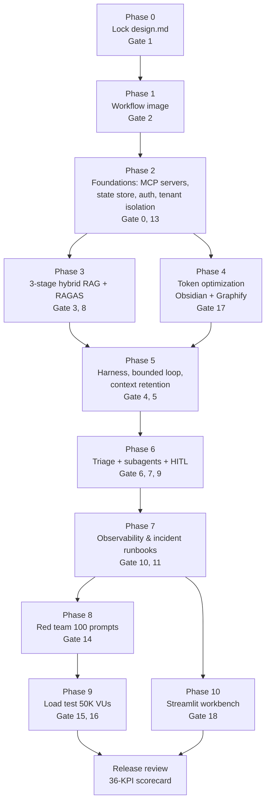
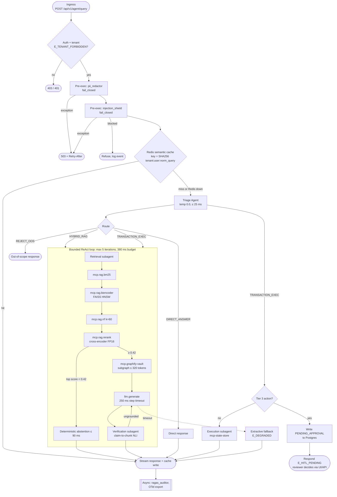
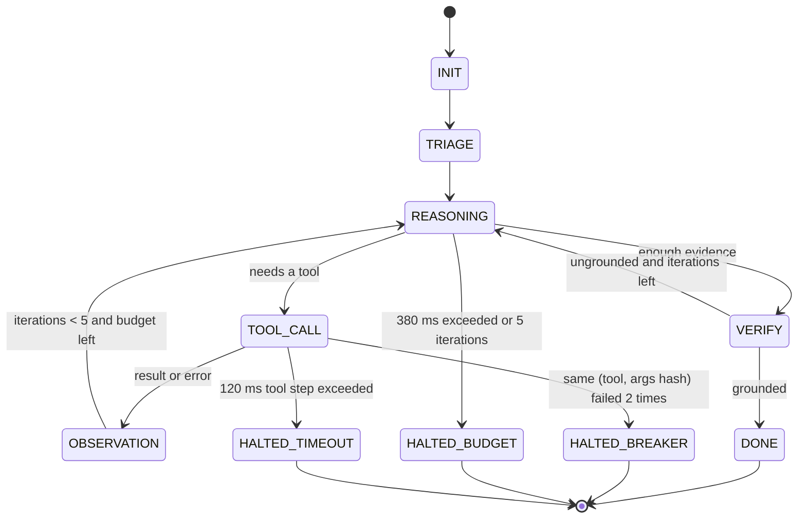
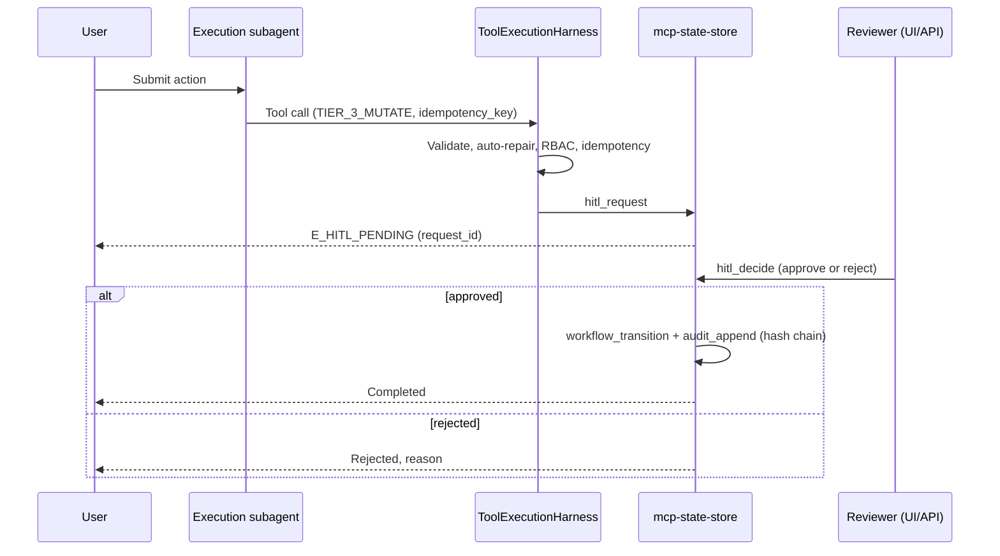

# workflow.md — Build & Runtime Workflow for "The Unreliable Assistant"

Written for: the engineers and reviewers who will build, test, and release the system.
Companion to `design.md`. Where this file and `design.md` disagree, `design.md` wins and this file must be corrected.
Status: DRAFT. Depends on `design.md` being locked (Phase 0).

---

## Part A — Build Workflow (how the work is sequenced)

### A.1 Ground rules
1. **No application code before `design.md` is locked** (Blueprint Gate 1, hard gate). CI enforces this: the build pipeline fails if `design.md` is missing, has unresolved Section 9 items, or has conflicts in Section 8 without a resolution.
2. **The Gate 2 workflow image is a pre-build artifact** (`docs/workflow_orchestration.png`, 300 DPI). This file is its text source. The PNG must be generated before Phase 2 begins.
3. **Every phase ends with an exit check** (A.3). A phase is not complete until its checks pass in CI, not when the code is written.
4. **Design changes go through an ADR**, not a silent edit to `design.md`.

### A.2 Phase sequence

Phases 3 and 4 can run in parallel after Phase 2. Phase 10 can start once Phase 7 emits traces, since Tabs 5 and 6 need them.

### A.3 Phase details and exit checks

| Phase | Work | Exit check (all must pass in CI) | Owner role |
|---|---|---|---|
| **0. Design lock** | Finish `design.md` Section 8 resolutions and Section 9 decisions. Supply missing Blueprint content (C15). | Reviewer sign-off; no open Section 9 items; FMEA reviewed | Architect + reviewer |
| **1. Workflow image** | Generate `docs/workflow_orchestration.png` from Part B diagrams with Graphviz at 300 DPI | Image exists; Gate 2 checklist items (Part B) all visible in the image | Architect |
| **2. Foundations** | `mcp-hybrid-rag`, `mcp-state-store`, `mcp-graphify-vault` skeletons; FastAPI app; `ToolExecutionHarness`; Pydantic contracts; tenant-scoped repository layer; hash-chained audit log | Contract tests pass for every schema in `design.md` § 1.2; tenant test: a query without `tenant_id` fails the build; `mcp_config.json` loads; signed manifests verified | Backend lead |
| **3. Hybrid RAG** | BM25 (`k1 1.25`, `b 0.75`), FAISS HNSW + bge-large ONNX, RRF (k = 60), cross-encoder (FP16, threshold 0.42); golden set of 250 questions; RAGAS scoring | KPI-07 to KPI-13 pass on the golden set; RAGAS release gates (faithfulness ≥ 0.92, relevancy ≥ 0.90, precision ≥ 0.88, recall ≥ 0.85, entity recall ≥ 0.85) | Retrieval lead |
| **4. Token optimization** | Obsidian notes with frontmatter; `graphify build` → `graph.json`; `graph_subgraph` tool with depth ≤ 2 and ≤ 320 tokens | KPI-26 ≥ 45% reduction, measured by the token counter hook, on the same golden set | Knowledge lead |
| **5. Agent control** | Deterministic state machine; loop ceilings (5 iterations, 120 ms tool step, 250 ms LLM step, 380 ms loop); circuit breaker; `GoalAnchorBlock`; observation compression; sliding window; `session_facts` | KPI-14 to KPI-18 pass; chaos loop suite shows 100% escape (KPI-16); no path exists to a recursive self-call without state change (static test) | Agent lead |
| **6. Routing & HITL** | Triage classifier (≤ 25 ms, temp 0.0); Retrieval / Execution / Verification subagents with tool-tier ceilings; async HITL with `PENDING_APPROVAL` | KPI-04 ≥ 97%; KPI-05 ≤ 25 ms; KPI-19 = 100% (Tier 3 never executes without approval, tested by a negative suite); fail-closed tests for PII and injection plugins | Agent lead |
| **7. Observability** | W3C traceparent through all hops; OTel collector → Prometheus, Tempo, Grafana; alert rules at warn 400 / page 450 ms; runbooks | Every span in § 1.10 appears in a test trace; alert rules deployed and tested with synthetic breaches | SRE |
| **8. Red team** | 100-prompt suite (five categories in `design.md` § 1.11) | KPI-02 ≥ 99.8%; KPI-03 ≥ 99.5%; KPI-24 hallucination ≤ 0.5%; any successful attack is a release blocker until fixed and re-run | Security |
| **9. Load** | k6 script and JMeter plan (50K VUs); soak test (1 hr) | KPI-31 to KPI-36 pass with raw output attached; KPI-27 measured with realistic repeat distribution (C11); LLM fleet sized per `design.md` § 1.4 | Performance |
| **10. Workbench** | Streamlit `app.py`, six tabs | Each tab reads live data from its source (not mock data); Tab 3 shows fail-closed plugins as locked | Frontend / full-stack |

### A.4 Release gate
A release is allowed only when:
1. Every phase exit check (A.3) is green in CI.
2. The **36-KPI scorecard** is generated from raw test output. Each KPI row has a value, a threshold, a pass or fail, and a link to its artifact.
3. The Audit's numbers are either re-produced by this scorecard or removed from the record.
4. No KPI is marked "pass" from a document alone.

---

## Part B — Runtime Workflow (what happens per request)

This is the text version of the Gate 2 workflow image. The node names match `design.md`.

### B.1 Request flow

### B.2 Triage routing

| Output | When | Next step | Max latency (p95) |
|---|---|---|---|
| `REJECT_OOS` | Outside the knowledge domain | Fixed OOS response | 40 ms |
| `DIRECT_ANSWER` | Greeting, clarification, or answer from the session's own verified facts | One LLM call, no retrieval | ~60 ms + LLM |
| `HYBRID_RAG` | Knowledge question; **also the default on low confidence** | Bounded loop with retrieval | 429 ms e2e nominal |
| `TRANSACTION_EXEC` | Workflow action or form submission | Tier 3 check → HITL or Execution subagent | Read path + HITL |

### B.3 ReAct loop state machine

Each `HALTED_*` state returns a structured remediation prompt and writes an audit event. Nothing loops back from a `HALTED_*` state.

### B.4 Tier 3 HITL flow

Rule: a `workflow_transition` without a matching approved `hitl_decide` is rejected at the state store, not only in the harness. Two independent checks.

---

## Part C — Development Workflow (how people work day to day)

### C.1 Branching and review
- Trunk-based: short-lived feature branches from `main`; PRs under 400 changed lines where possible.
- Any change to `design.md` requires an ADR entry and a reviewer from the architecture group.
- Any change touching tenant scoping, the harness, the HITL path, or the audit log requires two reviewers, one from security.
- PR descriptions state which KPI(s) the change can affect and which test proves it.

### C.2 CI pipeline (in order; stop on first failure)
1. **Design gate:** `design.md` is locked and its version matches the branch's `design_version` marker.
2. **Lint and types:** `ruff`, `mypy --strict` on `mcp_servers/`, `agents/`, `harness/`.
3. **Contract tests:** every Pydantic model matches the JSON Schema in `design.md` § 1.2 (generated diff must be empty).
4. **Tenant-isolation tests:** repository layer rejects queries without `tenant_id`; Redis key prefix test; cross-tenant probe (KPI-28 = 0 leaks).
5. **Unit and integration tests:** including fail-closed plugin tests.
6. **Retrieval eval:** golden set, KPI-10 to KPI-13 (runs only when retrieval code or index changes).
7. **RAGAS eval:** faithfulness and related gates (runs on generation or retrieval changes).
8. **Loop chaos suite:** KPI-16 must be 100%.
9. **Red-team smoke (20 prompts) on every PR; full 100 nightly.**
10. **Load smoke** (nightly, not per PR): short k6 run with the same thresholds, scaled down.
11. **Scorecard:** generated from artifacts; a PR cannot merge with a red KPI unless marked `kpi-exception` and approved by the architect.

### C.3 Incident workflow
1. Alert fires (Part `design.md` § 1.10).
2. On-call applies the mitigation from the runbook **first**, then investigates.
3. Trace ID from the alert goes into the incident log; the relevant span waterfall is linked.
4. Post-incident: if the root cause is a design gap, open an ADR; if it is a test gap, add the failing case to the suite before the fix.

### C.4 Definition of done (per task)
- Code is merged with tests that map to a KPI or a contract.
- Span names match `design.md` § 1.10.
- No raw PII in logs, fixtures, or test snapshots (CI scans fixtures).
- Documentation of any new config key is added to `mcp_config.json` docs.

---

## Part D — Open items that block this workflow
The open questions from `design.md` § 9 are now decided. Each decision is recorded there.

| # | Decision | Effect on this workflow |
|---|---|---|
| 1 | Per-user cache keys (ADR-03). KPI-27 measured on a repeat-query workload | Phase 2 cache code uses the per-user key; Phase 9 load plan uses repeat-user data |
| 2 | Loop budget 380 ms; e2e SLA unchanged | Phase 5 ceilings |
| 3 | Gate 8 and Step 6/10 defaults: nightly golden-set RAGAS plus 5% async production sampling; spans per § 1.10 | Phase 3 continuous eval job; Phase 7 span tests. Confirm against original Blueprint text |
| 4 | Audit numbers are claims until the Phase 9 scorecard regenerates them | Phase 9 release review |
| 5 | Size LLM fleet for 2,100 in-flight generations (1.5× headroom) | Phase 9 load plan and capacity sizing |
| 6 | p99 gate ≤ 600 ms; alert at 550 ms | Phase 7 alert rules; Phase 9 k6 thresholds |
| 7 | Gate 2 PNG: rendered with Graphviz at 300 DPI to `docs/workflow_orchestration.png` | Phase 1 exit: **done**. Streamlit Tab 1 can now load it |

No open design items remain in this table. Reviewer sign-off and named owners are still pending.
